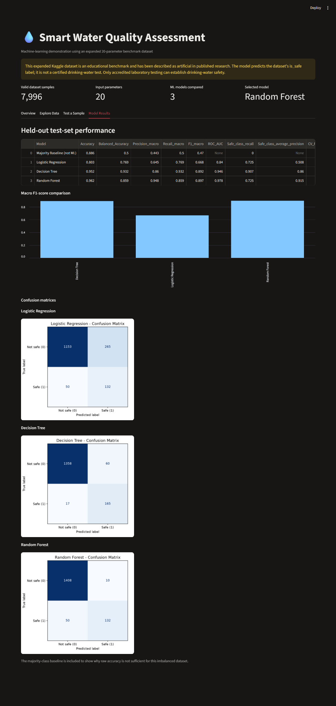
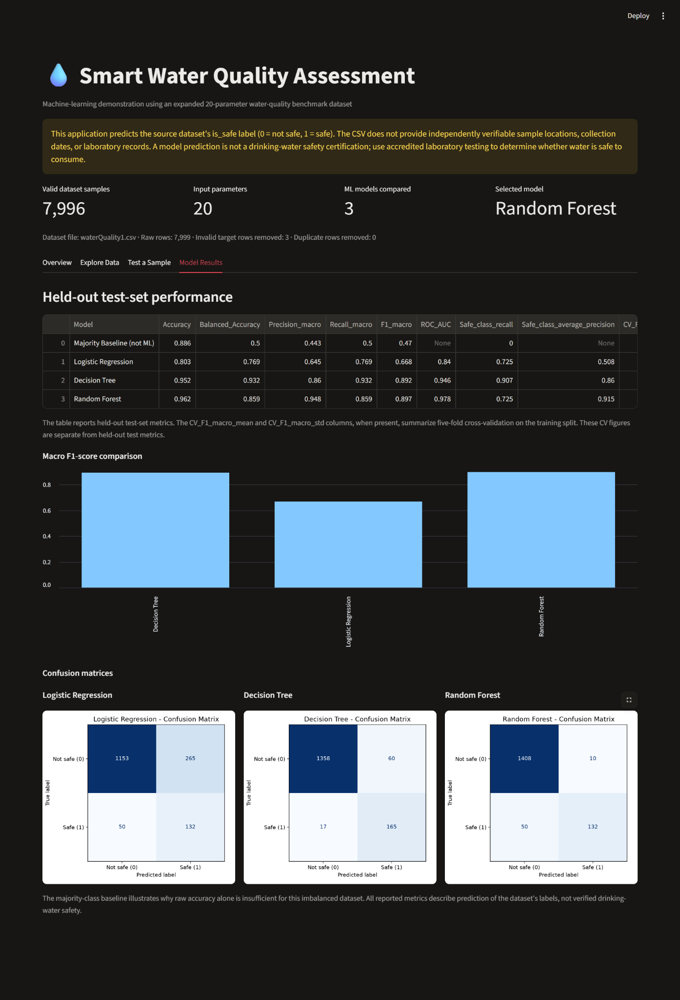

# Smart Water Quality Assessment and Potability Prediction Using Machine Learning

An individual Machine Learning mini-project that explores water-quality measurements and predicts the `is_safe` label supplied with a public Kaggle benchmark dataset. The project covers data validation, exploratory data analysis (EDA), preprocessing, model training and comparison, and an interactive Streamlit dashboard.

> **Important limitation:** This application predicts labels from the source dataset. The dataset does not provide independently verifiable sample locations, collection dates, or laboratory records. A model output is not a drinking-water safety certification and must not be used to decide whether water is safe to consume. Use accredited laboratory testing for real-world water-quality decisions.

## Dashboard screenshots

### Overview



### Model comparison and confusion matrices



## Project objectives

1. Explore 20 chemical and biological water-quality indicators.
2. Inspect class distribution, data quality, descriptive statistics and feature relationships.
3. Prepare the data and train three supervised classification algorithms.
4. Compare the classifiers using a stratified hold-out test set and five-fold cross-validation on the training split.
5. Provide an interactive application for dataset exploration, model comparison and sample prediction.

## Dataset

- **Dataset:** Water Quality (`waterQuality1.csv`)
- **Source:** [Kaggle – Water Quality dataset by MsSmartyPants](https://www.kaggle.com/datasets/mssmartypants/water-quality)
- **Target:** `is_safe` (`0` = not safe label, `1` = safe label)
- **Raw records in the supplied CSV:** 7,999
- **Rows retained after target validation:** 7,996
- **Input features:** 20

The 20 input features are:

`aluminium`, `ammonia`, `arsenic`, `barium`, `cadmium`, `chloramine`, `chromium`, `copper`, `flouride`, `bacteria`, `viruses`, `lead`, `nitrates`, `nitrites`, `mercury`, `perchlorate`, `radium`, `selenium`, `silver`, and `uranium`.

The source CSV spells the fluoride feature as `flouride`; the code accepts this spelling and also normalizes `fluoride` to the expected feature name.

### Dataset validation notes

The uploaded CSV used for this run contained 7,999 rows. Three rows had an invalid target token and were excluded, leaving 7,996 labelled samples. The cleaned target distribution was:

| Label | Meaning in the source dataset | Samples | Share |
|---|---|---:|---:|
| 0 | Not safe | 7,084 | 88.59% |
| 1 | Safe | 912 | 11.41% |

The dataset audit found no exact duplicate rows and no repeated 20-feature combinations among the retained records. Ten retained rows contain a negative ammonia value (minimum `-0.08`); these values were flagged as data-quality anomalies and were not silently removed. The source CSV does not include sufficient laboratory or geographic metadata to independently validate the labels.

The dataset is downloaded manually from Kaggle because Kaggle may require account sign-in. The CSV is intentionally not committed to this repository. See [Dataset setup](#dataset-setup).

## Methodology

1. Read the CSV and normalize column names.
2. Convert numeric fields and non-numeric error tokens to numeric/missing values.
3. Remove rows without a valid binary `is_safe` target; three invalid-target rows were removed in the reported dataset run.
4. Check for exact duplicate rows and duplicate predictor combinations.
5. Split the data into 80% training and 20% held-out testing using stratification and `random_state=42`.
6. Apply median imputation within each model pipeline. The imputer is fitted on training data only.
7. Apply standard scaling in the Logistic Regression pipeline.
8. Train Logistic Regression, Decision Tree and Random Forest classifiers.
9. Evaluate on the held-out test split. Use five-fold stratified cross-validation on the training split to compare model stability and select the default model by mean macro F1.

### Algorithms

- **Logistic Regression:** linear classification baseline with scaling and class weighting.
- **Decision Tree:** tree-based classifier with depth and leaf-size constraints.
- **Random Forest:** ensemble of decision trees with class weighting.

## Experimental results

The following metrics are from the Windows training run on the cleaned 7,996-row dataset, using an 80:20 stratified split. The test set contained 1,600 samples. Cross-validation values are calculated on the training split only and are shown separately from the held-out test metrics.

| Model | Accuracy | Balanced accuracy | Macro precision | Macro recall | Macro F1 | ROC-AUC | Safe-class recall | Safe-class average precision | CV macro F1 (mean ± SD) |
|---|---:|---:|---:|---:|---:|---:|---:|---:|---:|
| Majority baseline (not ML) | 88.6% | 0.500 | 0.443 | 0.500 | 0.470 | — | 0.000 | — | — |
| Logistic Regression | 80.3% | 0.769 | 0.645 | 0.769 | 0.668 | 0.840 | 0.725 | 0.508 | 0.678 ± 0.015 |
| Decision Tree | 95.2% | **0.932** | 0.860 | **0.932** | 0.892 | 0.946 | **0.907** | 0.860 | 0.882 ± 0.011 |
| Random Forest | **96.25%** | 0.859 | **0.948** | 0.859 | **0.897** | **0.978** | 0.725 | **0.915** | **0.888 ± 0.019** |

Random Forest was selected as the default model because it achieved the highest five-fold cross-validation macro F1 mean (`0.888`) among the three ML classifiers. Its held-out macro F1 was `0.897`. Decision Tree had a higher balanced accuracy (`0.932`) and safe-class recall (`0.907`), so it performed better at recovering the minority safe class on this test split. The difference between the Random Forest and Decision Tree cross-validation means is small; the result should not be described as a decisive superiority.

The majority baseline achieves 88.6% accuracy by always predicting the majority class. Its safe-class recall is zero. This illustrates why accuracy alone is not an adequate metric for this imbalanced dataset.

### Confusion matrices

Rows are actual labels and columns are predicted labels. Class 0 is the source dataset's not-safe label; class 1 is its safe label.

**Logistic Regression**

| Actual \ Predicted | Not safe (0) | Safe (1) |
|---|---:|---:|
| Not safe (0) | 1,153 | 265 |
| Safe (1) | 50 | 132 |

**Decision Tree**

| Actual \ Predicted | Not safe (0) | Safe (1) |
|---|---:|---:|
| Not safe (0) | 1,358 | 60 |
| Safe (1) | 17 | 165 |

**Random Forest**

| Actual \ Predicted | Not safe (0) | Safe (1) |
|---|---:|---:|
| Not safe (0) | 1,408 | 10 |
| Safe (1) | 50 | 132 |

## Streamlit application

The dashboard contains four sections:

- **Overview:** dataset size, number of input parameters, model count, label distribution and dataset preview.
- **Explore Data:** missing-value analysis, descriptive statistics and feature correlation heatmap.
- **Test a Sample:** enter the 20 feature values and view the selected model's predicted source-dataset label and probability.
- **Model Results:** held-out test metrics, macro F1 comparison and confusion matrices for the three classifiers.

The probability shown by the application is the model's estimated probability of the source dataset's `is_safe` label. It is not the probability that real-world water is safe to drink.

## Installation and execution on Windows (64-bit)

### Requirements

- 64-bit Windows
- Python 3.10 or newer
- Visual Studio Code (recommended)
- Internet access for package installation and the Kaggle dataset download

### Dataset setup

1. Open the [Kaggle dataset page](https://www.kaggle.com/datasets/mssmartypants/water-quality) and download the dataset. Sign in to Kaggle if prompted.
2. Extract the archive.
3. Place `waterQuality1.csv` inside the project's `data` folder:

```text
Smart_Water_Quality_ML/
└── data/
    └── waterQuality1.csv
```

4. The CSV is excluded by `.gitignore`; do not commit it to this repository.

### First-time setup

Open the project folder in VS Code, open a terminal in the project root, and run:

```powershell
.\setup_windows.bat
```

The setup script creates `.venv`, installs the packages listed in `requirements.txt`, checks that the Kaggle CSV is present, and runs the training pipeline to generate model and results files.

### Launch the dashboard

Use either method:

```powershell
.\run_app.bat
```

Or in VS Code, open **Run and Debug**, select **Run Smart Water Quality Dashboard**, and press **F5**.

The dashboard normally opens at `http://localhost:8501`.

### Run training separately

```powershell
.\.venv\Scripts\python.exe download_data.py
.\.venv\Scripts\python.exe train.py
```

## Project structure

```text
smart-water-quality-assessment-ml/
├── .vscode/                 # VS Code launch configuration
├── data/                    # Kaggle CSV (download separately; git-ignored)
├── docs/
│   ├── screenshots/         # README dashboard screenshots
│   └── DATA_AUDIT.md        # Dataset audit notes
├── models/                  # Trained model bundle used by the dashboard
├── notebooks/               # Project walkthrough notebook
├── results/                 # Metrics, reports, EDA charts and confusion matrices
├── app.py                   # Streamlit application
├── download_data.py         # Checks local Kaggle CSV availability
├── train.py                 # Preprocessing, training and evaluation
├── setup_windows.bat        # Windows environment setup
├── run_app.bat              # Launches Streamlit
├── requirements.txt
├── PROJECT_NOTES.md
├── LICENSE
└── README.md
```

## Limitations and future work

- The target labels are those supplied by the Kaggle dataset; they have not been independently validated against laboratory records.
- The CSV does not provide independently verifiable sample locations, collection dates or laboratory identifiers.
- The class distribution is imbalanced, so accuracy alone can be misleading. Macro F1, balanced accuracy and class-specific recall are also reported.
- Ten retained rows contain negative ammonia values; these are documented as potential data-quality anomalies and require domain review.
- The reported results come from one stratified train/test split plus five-fold cross-validation on the training split. External validation on independently collected laboratory data is not included.
- This project does not determine compliance with BIS or other drinking-water standards and is not a substitute for laboratory testing.

Possible future work includes evaluation on verified regional groundwater datasets, calibration, repeated external validation, and review with water-quality specialists. Additional datasets should only be combined after checking units, measurement methods, and feature definitions.

## References and attribution

- Dataset: [MsSmartyPants – Water Quality (Kaggle)](https://www.kaggle.com/datasets/mssmartypants/water-quality)
- Python libraries: [Pandas](https://pandas.pydata.org/), [NumPy](https://numpy.org/), [scikit-learn](https://scikit-learn.org/), [Matplotlib](https://matplotlib.org/) and [Streamlit](https://streamlit.io/).

The repository's license applies to the project code only. The dataset remains subject to its publisher's terms and attribution requirements. Acknowledge external datasets, libraries, and assistance in academic submissions.
