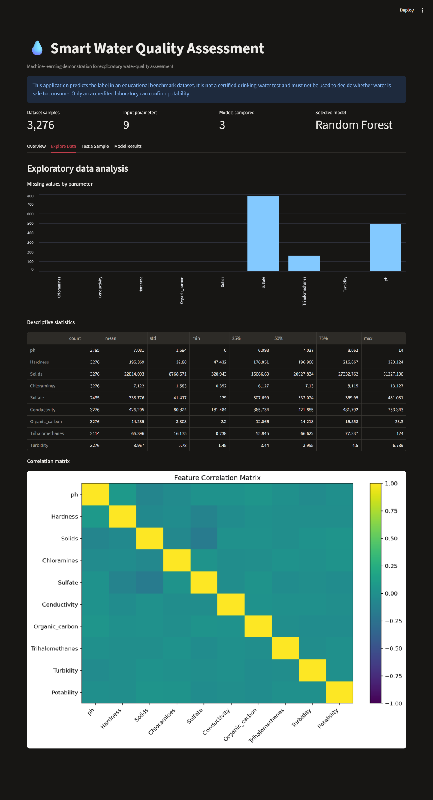
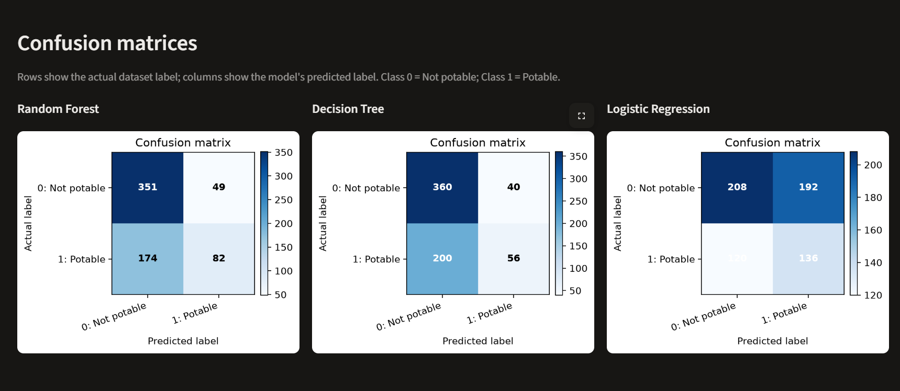

# Smart Water Quality Assessment and Potability Prediction Using Machine Learning

A supervised machine-learning mini-project that explores water-quality measurements and predicts the `Potability` label in a public educational dataset. The project includes data preprocessing, exploratory data analysis (EDA), training and comparison of three classification algorithms, and an interactive Streamlit dashboard.

> **Important limitation:** This application predicts labels from an educational benchmark dataset. It is not a certified drinking-water test, does not establish compliance with Indian drinking-water standards, and must not be used to decide whether water is safe to consume. Only an accredited laboratory can confirm water quality for real-world use.

**Repository:** [tagorenaiduchitti/smart-water-quality-assessment-ml](https://github.com/tagorenaiduchitti/smart-water-quality-assessment-ml)

## Dashboard screenshots

### Overview


### Exploratory data analysis



### Model evaluation and confusion matrices



## Project objectives

1. Explore nine numerical water-quality parameters in the dataset.
2. Inspect missing values, descriptive statistics and feature relationships.
3. Preprocess the data and train three supervised classification models.
4. Compare model performance on a held-out test set using suitable metrics.
5. Provide a small interactive interface for exploring the dataset, viewing model results and testing a sample input.

## Dataset

- **Dataset:** Water Potability (CSV)
- **Common dataset page:** [Kaggle – Water Potability](https://www.kaggle.com/datasets/adityakadiwal/water-potability)
- **CSV mirror used by the download script:** [GitHub raw CSV](https://raw.githubusercontent.com/edanurb/Water-Quality-Dataset-pytorch/main/water_potability.csv)
- **Records in the run shown below:** 3,276
- **Input features:** 9
- **Target:** `Potability` (`0` = non-potable label in this dataset; `1` = potable label in this dataset)

The nine input features are:

| Feature | Description |
|---|---|
| `ph` | pH measurement |
| `Hardness` | Water hardness |
| `Solids` | Total dissolved solids |
| `Chloramines` | Chloramines measurement |
| `Sulfate` | Sulfate measurement |
| `Conductivity` | Electrical conductivity |
| `Organic_carbon` | Organic carbon measurement |
| `Trihalomethanes` | Trihalomethanes measurement |
| `Turbidity` | Turbidity measurement |

The CSV is downloaded into `data/water_potability.csv` by `download_data.py`. The dataset is not an Indian regional monitoring dataset; the application therefore does not claim to represent local groundwater conditions.

## Methodology

1. Load the CSV and validate the required columns and binary target.
2. Remove duplicate rows and rows without a target label.
3. Perform EDA, including missing-value counts, descriptive statistics, class distribution and a correlation heatmap.
4. Split the data into **80% training and 20% test sets**, using stratification and `random_state=42`.
5. Handle missing numerical values with median imputation inside each model pipeline. This ensures the imputer is fitted on the training data only.
6. Apply standard scaling in the Logistic Regression pipeline.
7. Train and compare Logistic Regression, Decision Tree and Random Forest classifiers.
8. Evaluate the models on the held-out test set.

### Algorithms compared

- **Logistic Regression:** baseline linear classifier; feature scaling is included in its pipeline.
- **Decision Tree:** tree-based classifier with depth and leaf-size constraints.
- **Random Forest:** ensemble of decision trees.

## Experimental results

The following results are from the local run used for the screenshots in this repository. Values are rounded to three decimal places. They are results from one stratified 80/20 hold-out split, not cross-validation or external validation.

| Model | Accuracy | Macro precision | Macro recall | Macro F1 | ROC-AUC | Recall, class 0 |
|---|---:|---:|---:|---:|---:|---:|
| **Random Forest** | **0.660** | **0.647** | **0.599** | **0.591** | **0.658** | 0.878 |
| Decision Tree | 0.634 | 0.613 | 0.559 | 0.534 | 0.591 | **0.900** |
| Logistic Regression | 0.524 | 0.524 | 0.526 | 0.519 | 0.547 | 0.520 |

Random Forest has the highest accuracy, macro precision, macro recall, macro F1 and ROC-AUC in this run, so it is selected as the default model in the dashboard. Decision Tree has the highest recall for class 0, so it identifies a larger proportion of the dataset's non-potable-labelled samples in this test split. This is a useful trade-off to discuss rather than claiming that one model is best on every metric.

### Confusion matrices

Rows represent actual labels and columns represent predicted labels. Class 0 is the dataset's non-potable label; class 1 is the dataset's potable label.

**Random Forest**

| Actual \ Predicted | Class 0 | Class 1 |
|---|---:|---:|
| Class 0 | 351 | 49 |
| Class 1 | 174 | 82 |

**Decision Tree**

| Actual \ Predicted | Class 0 | Class 1 |
|---|---:|---:|
| Class 0 | 360 | 40 |
| Class 1 | 200 | 56 |

**Logistic Regression**

| Actual \ Predicted | Class 0 | Class 1 |
|---|---:|---:|
| Class 0 | 208 | 192 |
| Class 1 | 120 | 136 |

### EDA observations from the same dataset run

| Feature | Missing values | Approx. share of 3,276 rows |
|---|---:|---:|
| Sulfate | 781 | 23.84% |
| pH | 491 | 14.99% |
| Trihalomethanes | 162 | 4.95% |

Sulfate has the largest number of missing measurements in this dataset. Median imputation is used for the model pipelines. The pH minimum in the descriptive statistics is 0; this extreme value is retained in the dataset and should be treated as a data-quality observation, not silently interpreted as a normal measurement.

## Streamlit application

The dashboard contains four tabs:

- **Overview:** dataset size, feature count, model count, class distribution and a dataset preview.
- **Explore Data:** missing-value chart, descriptive statistics and correlation heatmap.
- **Test a Sample:** enter the nine measurements and view the selected model's predicted dataset label and probability.
- **Model Results:** held-out test metrics, macro F1 comparison and confusion matrices for all three classifiers.

The probability displayed by the application is the model's estimated probability for a dataset label. It is not a probability that real-world water is safe to drink.

## Run the project on Windows (64-bit)

### Requirements

- 64-bit Windows
- Python 3.10 or newer
- Visual Studio Code (recommended) or a terminal
- Internet connection for the first-time package installation and dataset download

### First-time setup

1. Clone or download this repository and open the project folder in VS Code.
2. Open the VS Code terminal in the project root.
3. Run:

```powershell
.\setup_windows.bat
```

The setup script creates `.venv`, installs packages from `requirements.txt`, downloads the dataset and runs `train.py` to generate the saved model and evaluation files.

### Launch the dashboard

Use either option:

```powershell
.\run_app.bat
```

Or in VS Code, open **Run and Debug**, select **Run Smart Water Quality Dashboard**, and press **F5** (the `.vscode/launch.json` configuration uses the project's virtual environment).

The dashboard normally opens at `http://localhost:8501`.

### Run the training steps separately

After setup, the equivalent commands are:

```powershell
.\.venv\Scripts\python.exe download_data.py
.\.venv\Scripts\python.exe train.py
.\.venv\Scripts\python.exe -m streamlit run app.py
```

## Project structure

```text
.
├── .vscode/
│   └── launch.json
├── data/                         # downloaded CSV; not committed
├── docs/
│   └── screenshots/              # dashboard screenshots used in this README
├── models/                       # trained model bundle generated by train.py
├── notebooks/
│   └── 01_project_walkthrough.ipynb
├── results/                      # metrics, reports, EDA outputs and confusion matrices
├── app.py                        # Streamlit dashboard
├── download_data.py               # dataset download helper
├── train.py                       # preprocessing, EDA, training and evaluation
├── setup_windows.bat              # first-time Windows setup
├── run_app.bat                    # launch dashboard
├── requirements.txt
├── PROJECT_NOTES.md
├── LICENSE
└── README.md
```

## Limitations and possible future work

- The benchmark dataset's provenance and labels do not establish compliance with any particular drinking-water regulation.
- The dataset is not geographically representative of West Bengal or any other local area.
- Results are based on one train/test split; repeated cross-validation and evaluation on independent, locally collected laboratory data would provide stronger evidence.
- A practical system would require validated measurements, domain-expert review, model calibration and ongoing monitoring.
- Future work could evaluate a separately sourced regional groundwater dataset, but datasets should only be combined after checking compatible units, measurement methods and feature definitions.

## References and attribution

- Dataset page: [Kaggle – Water Potability](https://www.kaggle.com/datasets/adityakadiwal/water-potability)
- CSV mirror used by this project's downloader: [edanurb/Water-Quality-Dataset-pytorch](https://github.com/edanurb/Water-Quality-Dataset-pytorch)
- Main libraries: [pandas](https://pandas.pydata.org/), [NumPy](https://numpy.org/), [scikit-learn](https://scikit-learn.org/), [Matplotlib](https://matplotlib.org/) and [Streamlit](https://streamlit.io/).

The repository's MIT license applies to the project code. The dataset remains subject to the terms and attribution requirements of its source. External datasets, libraries and assistance should be acknowledged in any academic submission.
